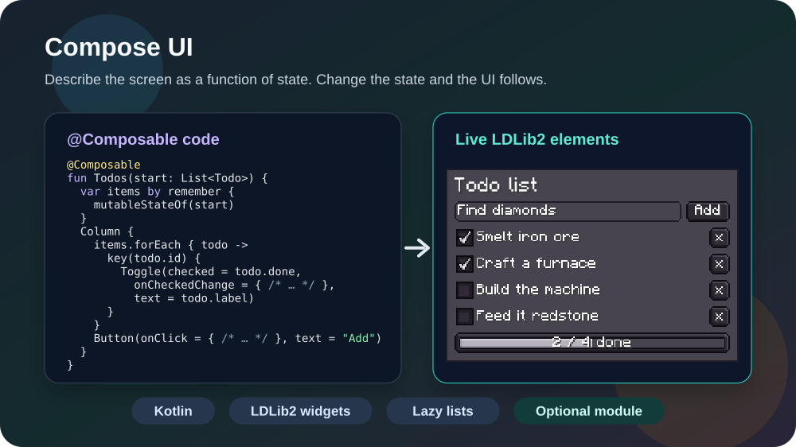
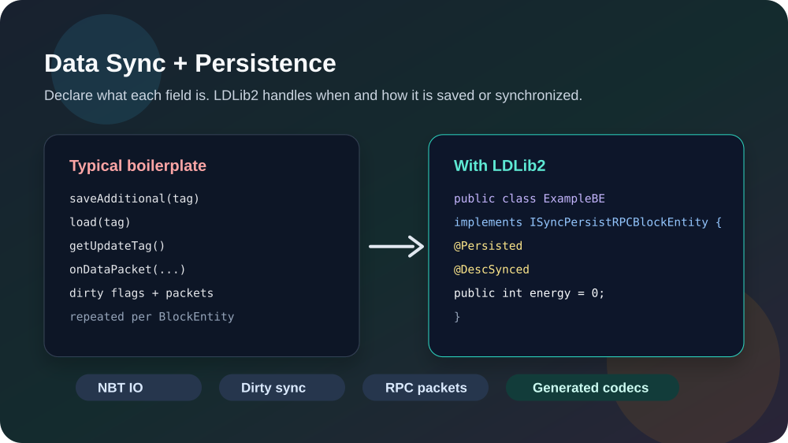
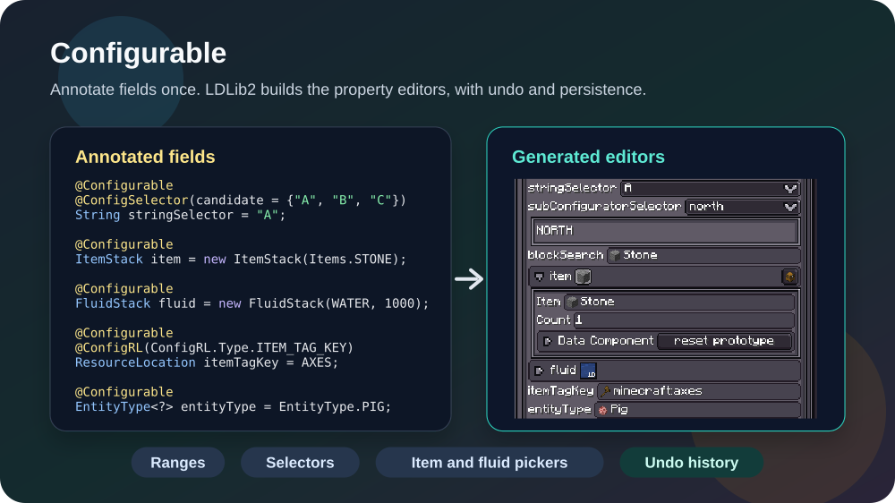
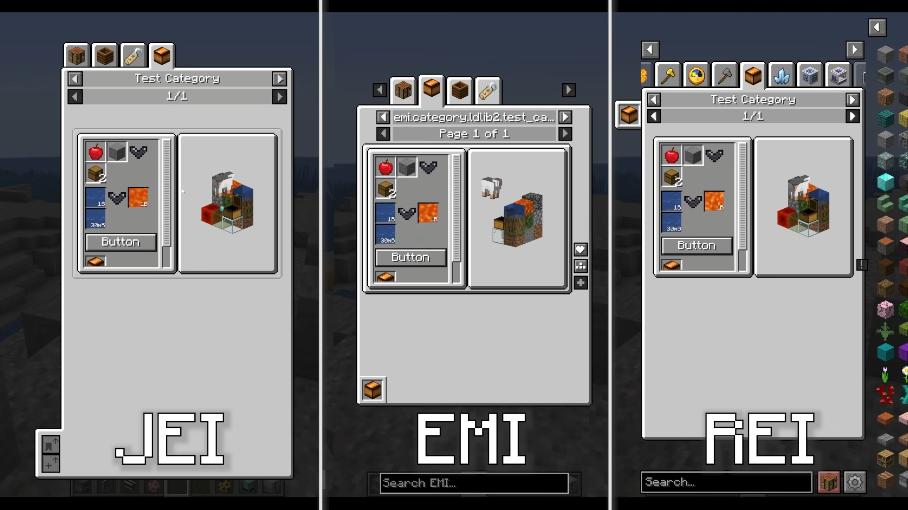
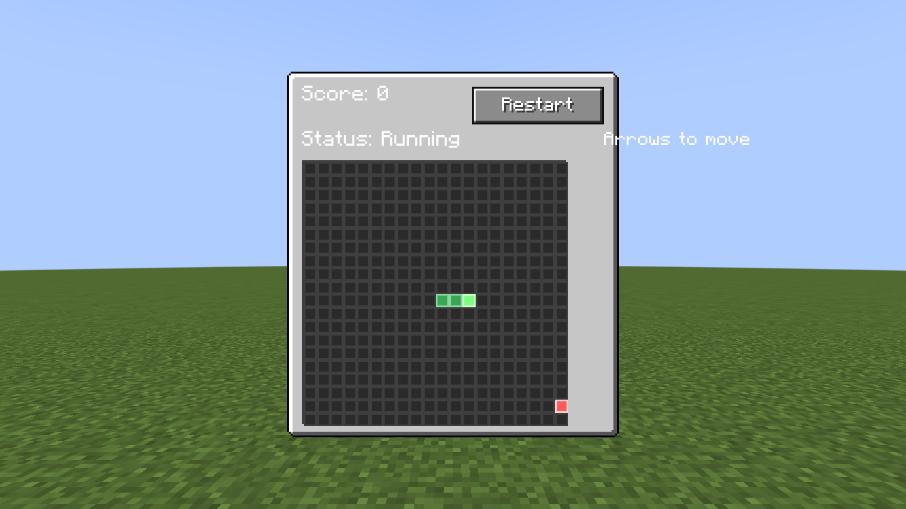

# LDLib2

<div align="center">

**A modern Minecraft modding library for UI, rendering, synchronization, persistence, and in-game editors.**

[](https://github.com/Low-Drag-MC/LDLib2/stargazers)
[](https://www.curseforge.com/minecraft/mc-mods/ldlib)
[](https://modrinth.com/mod/ldlib)
[](https://maven.firstdark.dev/snapshots/com/lowdragmc/ldlib2/)
[](https://neoforged.net/)
[](LICENSE)

[Documentation](https://low-drag-mc.github.io/LowDragMC-Doc/en/ldlib2/) |
[Java Integration](https://low-drag-mc.github.io/LowDragMC-Doc/en/ldlib2/java_integration.html) |
[UI Guide](https://low-drag-mc.github.io/LowDragMC-Doc/en/ldlib2/ui/) |
[Compose](https://low-drag-mc.github.io/LowDragMC-Doc/en/ldlib2/ui/compose/) |
[Discord](https://discord.com/invite/sDdf2yD9bh) |
[CurseForge](https://www.curseforge.com/minecraft/mc-mods/ldlib) |
[Modrinth](https://modrinth.com/mod/ldlib)

</div>

---

LDLib2 is a complete rewrite of the original [LDLib](https://github.com/Low-Drag-MC/LDLib-MultiLoader), redesigned around modern Minecraft and NeoForge development. It gives mod authors a higher-level foundation for building UI, in-game tools, renderer-backed content, synchronized data, and persistent runtime systems without rebuilding the same infrastructure in every project.

## Feature Highlights

<table>
<tr>
<td width="50%" valign="top">
<a href="https://www.youtube.com/watch?v=Ic5H3YoVPjQ"></a><br>
<strong><a href="https://www.youtube.com/watch?v=Ic5H3YoVPjQ">LDLib2 UI</a></strong><br>
Build Minecraft screens with Taffy-powered layout, LSS stylesheets, reusable components, XML definitions, data bindings, RPC events, and HUD overlays.
</td>
<td width="50%" valign="top">
<a href="https://low-drag-mc.github.io/LowDragMC-Doc/en/ldlib2/ui/compose/"></a><br>
<strong><a href="https://low-drag-mc.github.io/LowDragMC-Doc/en/ldlib2/ui/compose/">Compose UI</a></strong><br>
Write screens in Kotlin as a function of state on the Compose runtime. Lists, tabs, and dialogs follow your data, and every widget is a real LDLib2 element. Ships as the optional <code>ldlib2-compose</code> module.
</td>
</tr>
<tr>
<td width="50%" valign="top">
<a href="https://low-drag-mc.github.io/LowDragMC-Doc/en/ldlib2/sync/"></a><br>
<strong><a href="https://low-drag-mc.github.io/LowDragMC-Doc/en/ldlib2/sync/">Data Synchronization and Persistence</a></strong><br>
Annotate fields with <code>@Persisted</code>, <code>@DescSynced</code>, and RPC helpers to generate NBT IO, codecs, dirty-field sync, and packet flow with minimal boilerplate.
</td>
<td width="50%" valign="top">
<a href="https://low-drag-mc.github.io/LowDragMC-Doc/en/ldlib2/configurable/"></a><br>
<strong><a href="https://low-drag-mc.github.io/LowDragMC-Doc/en/ldlib2/configurable/">Configurable</a></strong><br>
Turn annotated Java objects into inspector-ready property panels, including ranges, selectors, lists, item and fluid pickers, search fields, undo history, and persistence.
</td>
</tr>
<tr>
<td width="50%" valign="top">
<a href="https://low-drag-mc.github.io/LowDragMC-Doc/en/ldlib2/node-graph-toolkit/"></a><br>
<strong><a href="https://low-drag-mc.github.io/LowDragMC-Doc/en/ldlib2/node-graph-toolkit/">Node Graph Toolkit</a></strong><br>
Create in-game graph editors with nodes, ports, wires, variables, subgraphs, blackboards, auto layout, undoable commands, and resource-backed graph assets.
</td>
<td width="50%" valign="top">
<a href="https://low-drag-mc.github.io/LowDragMC-Doc/en/ldlib2/editor/"></a><br>
<strong><a href="https://low-drag-mc.github.io/LowDragMC-Doc/en/ldlib2/editor/">In-game Editor Framework</a></strong><br>
Build Unity-, Blender-, or Blockbench-style tools with dockable views, project files, an asset browser, inspectors, history, rebindable shortcuts, and settings.
</td>
</tr>
<tr>
<td width="50%" valign="top">
<a href="https://low-drag-mc.github.io/LowDragMC-Doc/en/ldlib2/ui/xei_support.html"></a><br>
<strong><a href="https://low-drag-mc.github.io/LowDragMC-Doc/en/ldlib2/ui/xei_support.html">Rendering and Integrations</a></strong><br>
Use LDLib2's shader, texture, model rendering, and scene utilities together with JEI, REI, EMI, KubeJS, and Java plugin entry points.
</td>
<td width="50%" valign="top">
<a href="https://low-drag-mc.github.io/LowDragMC-Doc/en/ldlib2/ui/testing/"></a><br>
<strong><a href="https://low-drag-mc.github.io/LowDragMC-Doc/en/ldlib2/ui/testing/">UI Test Harness</a></strong><br>
Script scenarios that open real UIs in a real client, click and type through them, wait for server sync, and save screenshots and reports. Runs headless, in parallel, or on a dedicated server with several clients.
</td>
</tr>
</table>

## Java Integration

LDLib2 is published to the FirstDark Maven snapshots repository.

```gradle
repositories {
    maven { url = "https://maven.firstdark.dev/snapshots" }
}

dependencies {
    implementation("com.lowdragmc.ldlib2:ldlib2-neoforge-${minecraft_version}:${ldlib2_version}:all")
}
```

For LDLib2 versions before `2.2.1`, disable transitive dependencies and add Yoga manually:

```gradle
dependencies {
    implementation("com.lowdragmc.ldlib2:ldlib2-neoforge-${minecraft_version}:${ldlib2_version}:all") {
        transitive = false
    }
    compileOnly("org.appliedenergistics.yoga:yoga:1.0.0")
}
```

Recommended project variables:

```properties
minecraft_version=1.21.1
ldlib2_version=2.2.44
```

### Optional: Compose UI

[Compose UI](https://low-drag-mc.github.io/LowDragMC-Doc/en/ldlib2/ui/compose/) is a separate mod, `ldlib2-compose`, that your mod ships as Jar-in-Jar. It is written against Kotlin and needs the Kotlin Compose compiler plugin at the same version as your Kotlin plugin.

Its version starts with the Minecraft line it is built for: `21.0.0.1` is the first release for 1.21.1, and each Minecraft version gets its own build. Only 1.21.1 is published so far.

```gradle
dependencies {
    implementation "com.lowdragmc.ldlib2:ldlib2-compose-1.21.1:21.0.0.1"
    jarJar(group: 'com.lowdragmc.ldlib2', name: 'ldlib2-compose-1.21.1') {
        version { require '[21.0.0.1,)'; prefer '21.0.0.1' }
    }
}
```

See [Optional module: ldlib2-compose](https://low-drag-mc.github.io/LowDragMC-Doc/en/ldlib2/java_integration.html#optional-module-ldlib2-compose) for the plugin, repository, and `neoforge.mods.toml` setup.

### LDLib Plugin Entry Point

Create a plugin class when your mod needs to register LDLib2 resources, integrations, or startup hooks.

```java
import com.lowdragmc.lowdraglib2.plugin.ILDLibPlugin;
import com.lowdragmc.lowdraglib2.plugin.LDLibPlugin;

@LDLibPlugin
public class MyLDLibPlugin implements ILDLibPlugin {
    @Override
    public void onLoad() {
        // Register LDLib2 extensions here.
    }
}
```

## Quick UI Example

This creates a small `ModularUI` with a label, a button, and a styled root element.

```java
public class MyScreenUi {
    public static ModularUI createUi() {
        var root = new UIElement()
                .layout(layout -> layout.paddingAll(7).gapAll(5))
                .style(style -> style.background(Sprites.BORDER));

        root.addChildren(
                new Label().setText("My First LDLib2 UI"),
                new Button()
                        .setText("Click Me")
                        .setOnClick(event -> {
                            // Handle the click here.
                        })
        );

        return ModularUI.of(UI.of(root));
    }
}
```

For a full walkthrough, see the [UI Getting Started guide](https://low-drag-mc.github.io/LowDragMC-Doc/en/ldlib2/ui/getting_start.html).

With [Compose UI](https://low-drag-mc.github.io/LowDragMC-Doc/en/ldlib2/ui/compose/), the screen is a Kotlin function of its state, and changing the state updates the elements:

```kotlin
@Composable
fun Counter() {
    var count by remember { mutableStateOf(0) }

    Column(layout = { width(120.px); padding { all(6.px) }; gap { all(4.px) } }) {
        Text("Clicked $count times")
        Button(onClick = { count++ }, text = "Click")
    }
}

fun openCounter() {
    val mc = Minecraft.getInstance()
    val mui = composeModularUI(mc.player, StylesheetManager.MODERN) { Counter() }
    mc.setScreen(ModularUIScreen(mui, Component.literal("Counter")))
}
```

## Developer Tools

If you develop with LDLib2, install the LDLib Dev Tool IDEA plugin for editor assistance around LDLib2-specific files and annotations. The [Java Integration guide](https://low-drag-mc.github.io/LowDragMC-Doc/en/ldlib2/java_integration.html) covers code highlighting, syntax checks, jump-to-definition, autocomplete, and annotation support.

## Migrating from LDLib

LDLib2 is not a small patch over LDLib. It removes old systems and rebuilds the core architecture for Minecraft `1.21+`.

- Legacy UI and outdated framework pieces have been removed.
- UI layout, styling, events, and data flow have been redesigned.
- Documentation and examples are written around the new architecture.
- Compatibility work focuses on modern NeoForge and current modding integrations.

## Links

- [Documentation](https://low-drag-mc.github.io/LowDragMC-Doc/en/ldlib2/)
- [GitHub repository](https://github.com/Low-Drag-MC/LDLib2)
- [CurseForge project](https://www.curseforge.com/minecraft/mc-mods/ldlib)
- [Modrinth project](https://modrinth.com/mod/ldlib)
- [Discord community](https://discord.com/invite/sDdf2yD9bh)
- [Original LDLib](https://github.com/Low-Drag-MC/LDLib-MultiLoader)

## License

LDLib2 is licensed under the [LGPL-3.0 license](LICENSE).
